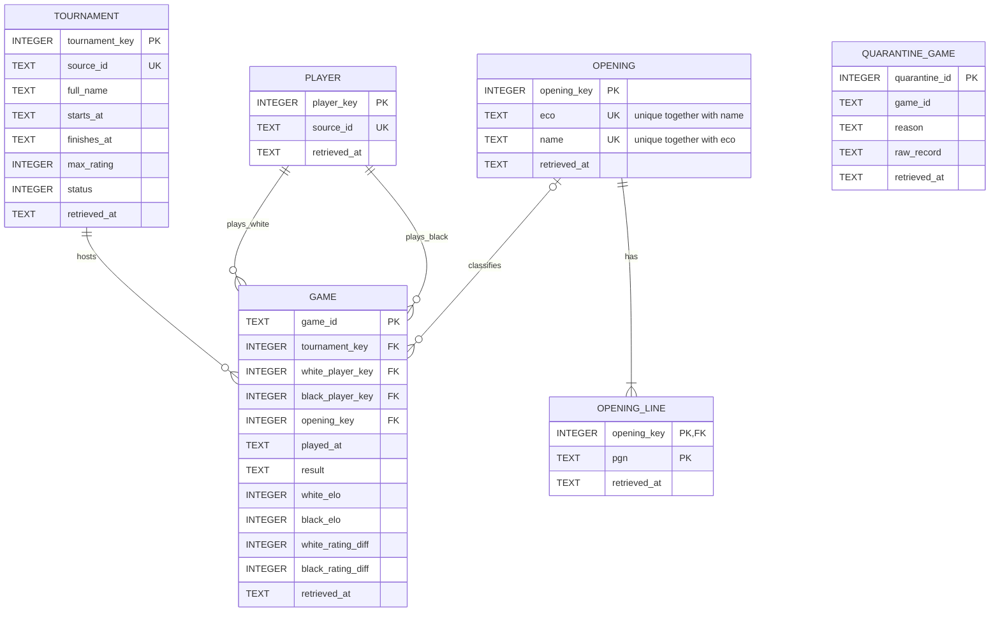

# Lichess Opening Outcomes Pipeline

## The question

We want to investigate which chess openings are associated with different game outcomes after accounting for the rating difference between the players and each player's color, and whether these patterns change across rating groups. We will first explore win rates and sample sizes by opening and rating band. We will then build a model that predicts game result using rating difference, color, and opening, with a time-based train/test split and a rating-only baseline to measure whether opening information adds predictive value. The results can show which openings perform differently from what rating alone would predict at different rating levels, providing evidence that can inform which openings to study for bullet chess.

## Data sources

Full details for each source are in [docs/sources.md](docs/sources.md).

- **Lichess recent finished tournaments** (metadata, JSON) via the Lichess API.
- **Lichess tournament games** (Hourly Bullet Arena, PGN export) via the Lichess API.
- **Lichess chess-openings** (ECO reference table, TSV) from [lichess-org/chess-openings](https://github.com/lichess-org/chess-openings).

Data from [lichess.org](https://lichess.org), released under CC0 1.0 (no attribution required, credited here anyway). A bounded sample of the raw data is committed to `data/raw/` so the repository can be inspected without an API token; the raw game files contain player usernames, which are not part of the analysis and are removed in M3. Anyone with a Lichess token can regenerate or extend the data by running the pipeline.

## How to run

### 1. Ingest (M1): land the raw data

1. Clone the repository and enter it:
   ```
   git clone https://github.com/denizef00/lichess-tournament-analysis
   cd lichess-tournament-analysis
   ```
2. Create and activate a virtual environment:
   ```
   python -m venv .venv
   # Windows:  .venv\Scripts\activate
   # macOS/Linux:  source .venv/bin/activate
   ```
3. Install requirements:
   ```
   pip install -r requirements.txt
   ```
4. Create a Lichess API token at https://lichess.org/account/oauth/token (no special scopes needed).
5. Copy `.env.example` to `.env` and put your token in it:
   ```
   LICHESS_API_TOKEN=your-token-here
   ```
   Optional variables (defaults in brackets): `LICHESS_NAME_FILTER` [Hourly Bullet], `MAX_TOURNAMENTS` [20], `MAX_RETRIES` [5], `CONTACT_INFO` [student-project].
6. Run the ingestion from the repository root:
   ```
   python src/ingest.py
   ```

Each run creates new timestamped files under `data/raw/` and prints a run summary at the end (files, records, failures). Earlier files are never overwritten.

### 2. Build the database (M2)

The database is derived data and is not committed. From a fresh clone with landed raw data in `data/raw/` (the committed sample is enough, no API token needed), run from the repository root:

```
python src/load.py      # builds the database from scratch, or updates it; safe to run repeatedly
python src/checks.py    # runs the six checks against a temporary copy of the database
```

The database is written to `data/lichess.db` (ignored by git). `load.py` reads only `data/raw/` and never calls the API. It needs SQLite 3.37 or newer (`STRICT` tables); check with `python -c "import sqlite3; print(sqlite3.sqlite_version)"`.

## Repository structure

```
├── README.md
├── .gitignore
├── .env.example          variable names with placeholder values
├── requirements.txt
├── data/
│   ├── raw/              landed raw data (committed sample, CC0)
│   │   ├── tournaments/  tournament list responses (JSON)
│   │   ├── games/        games per tournament (PGN)
│   │   └── openings/     ECO reference files (TSV)
│   └── lichess.db        built database (not committed)
├── sql/
│   ├── schema.sql        all tables, STRICT, safe to run more than once
│   └── queries/          analytical queries
├── src/
│   ├── ingest.py         ingestion script (M1)
│   ├── db.py             connect() and shared helpers
│   ├── load.py           loader: raw files -> database
│   ├── checks.py         six checks against a temporary copy
│   └── key_tests.py      key assumptions tested on the raw data
└── docs/sources.md       data source cards
```

## Data Model

### ER diagram



> `quarantine_game` is deliberately not linked to any table by a foreign key: it holds games that could not be loaded because no matching tournament or opening row exists. `game_id` and `raw_record` keep the source's raw values, and `reason` says why the game was not loaded.

> `game` uses the Lichess `GameId` as its primary key because it is an event table, and the id is what identifies one game. `opening` is unique on `(eco, name)` together; `eco` alone is not unique.

> `game.opening_key` is nullable: a game with no ECO/Opening tag (e.g. abandoned before the first move) has no opening recorded, which is a missing value, not a reference to an unknown entity. A game whose opening *is* given but missing from the reference table goes to `quarantine_game` (`unknown_opening`).

### Grain of every table

| Table | One row is... |
|---|---|
| `tournament` | one Lichess arena tournament (latest retrieved version) |
| `player` | one Lichess username |
| `opening` | one `(ECO code, opening name)` pair from the Lichess reference table |
| `opening_line` | one move sequence belonging to one opening |
| `game` | one finished game, identified by its Lichess `GameId` |
| `quarantine_game` | one game that could not be loaded, with the reason |

All tables are `STRICT`. Every table keeps `retrieved_at` (the landed file the row came from). Timestamps are ISO 8601 UTC text (`2026-10-08T11:55:37Z`).

### Decisions and findings

**Keys.** Entity tables (`tournament`, `player`, `opening`) have a surrogate `INTEGER PRIMARY KEY` and keep the source identifier as `NOT NULL UNIQUE` (tournament id, username, `(eco, name)`). `game` is an event table keyed on the Lichess `GameId`, which is what identifies one game. `opening_line` is keyed on `(opening_key, pgn)`.

Key tests run on the landed raw data:

| Test | Result |
|---|---|
| `GameId` unique after removing re-fetched copies | Held. 4539 game blocks in the raw files, 4539 distinct `GameId`s, 0 re-fetched copies. |
| Same `GameId` always has the same `Result`, `WhiteElo`, `BlackElo`, `ECO`, `Opening` | Held. 0 `GameId`s differ between copies (there are no copies in the committed sample, so this was trivially true). |
| `(eco, name)` repeated in the openings TSV | Did not hold as a key for the move sequence: 3865 distinct rows but only 3332 distinct `(eco, name)` pairs, and 266 pairs appear with more than one move sequence. This is why `opening_line` exists. |
| Same move sequence under more than one `(eco, name)` | Held. 0 sequences are shared, so `(opening_key, pgn)` is unique. |
| `(ECO, Opening)` pairs from games missing in the TSV | 4 of the 4152 games that carry an opening tag (0.10%). See Known issues. |
| Tournament ids (from game file names) missing from landed tournament files | 0 games. Every game's tournament is in a landed tournament file. |
| `played_at` inside the tournament's `starts_at`..`finishes_at` | Held. 0 games fall outside the window. |
| Usernames that differ only by case | Held. 1307 distinct usernames, 1307 case-insensitive. |
| Non-numeric `WhiteElo` / `BlackElo`, invalid `Result` | None found (0 and 0). |

The tests are in `src/key_tests.py`.

**Missing values.** A missing value in this source means "not recorded", never zero.
- `WhiteElo` / `BlackElo` that is `?` or not a number becomes `NULL`.
- `WhiteRatingDiff` / `BlackRatingDiff` with a leading sign (`+2`, `-11`) are converted to integers; anything that is not a number becomes `NULL`.
- A missing `WhiteBerserk` / `BlackBerserk` tag means no berserk (`0`), because Lichess only writes the tag when it is `true`.
- A missing or `?` `ECO` / `Opening` tag gives `opening_key = NULL`.
- Non-numeric values converted to `NULL` are counted in the run summary ("values cleaned").
- In the committed sample there were 0 non-numeric Elo or rating-change values, and 387 of 4539 games (8.5%) have no `ECO` / `Opening` tag, so their `opening_key` is `NULL`.

**Unknown references.** A game whose tournament id is not in any landed tournament file, or whose `(ECO, Opening)` is not in the openings table, is written to `quarantine_game` with a `reason` (`unknown_tournament`, `unknown_opening`, `bad_result`, `bad_timestamp`, `missing_player`) and its headers as JSON. It is never dropped silently and never crashes the load. Quarantining keeps the record visible and lets it be loaded later, once the missing tournament or reference row has been landed.

**Change over time.** We use type 1 (keep the latest version), decided by `retrieved_at`. Tournaments do change between fetches (`status` 10 created, 20 started, 30 finished, and `nb_players` grows), so the latest retrieved version wins. A Lichess user who renames their account will appear as a new player and split their history in two. The openings reference table can also change when Lichess updates it. M6 may revisit this.

**Known issues.**
- `white_rating_diff` / `black_rating_diff` are the rating change after the game. They are stored but must not be used as model features in M4 (leakage).
- The games sample only covers Hourly Bullet Arena tournaments.
- The tournament id is not in the PGN headers; it comes from the game file name (`<tournament_id>_<timestamp>.pgn`).
- Usernames are stored for now and removed in M3.
- Games without an opening (`opening_key IS NULL`) are excluded from opening-level analysis.
- 4 of 4539 games (0.09%) are quarantined as `unknown_opening`. Three carry `Indian Defense: Budapest Defense...` (ECO A51/A52) while the reference table lists the same opening as `Indian Defense: Budapest Gambit...`; one carries `French Defense: Classical Variation, Burn Variation` with ECO `C11`, while the reference table lists that name under `C13`. We suspect the game labels and the reference table use different naming versions; this is a guess, not verified. Fixing the mapping is left to M3.
- 387 games (8.5%) have no opening tag at all. We did not investigate why; they are loaded with `opening_key = NULL`.
- The committed sample contains no re-fetched game copies, so "latest retrieval wins" is not exercised by real game data. `checks.py` and the tournament files (the same tournament appears in several snapshots with different `status`) cover it instead.
- Records counted but not stored: a tournament without a start time, a game without a `GameId` and an openings row with an empty field are counted in the run summary but have no row in `quarantine_game` (none occurred in the sample).

### Analytical query

File: [`sql/queries/white_win_rate_by_opening.sql`](sql/queries/white_win_rate_by_opening.sql)

```sql
-- Question: which openings have the highest white win rate, among openings with at least 30 games?
-- Result grain: one row per opening (eco, name).
-- Each game is counted once at its own grain (one row in game); the join to opening is
-- many-to-one, so it cannot duplicate games. Games without an opening (NULL) drop out of the
-- inner join on purpose.
SELECT o.eco, o.name,
       COUNT(*) AS games,
       ROUND(AVG(g.result = '1-0'), 3) AS white_win_rate
FROM game g
JOIN opening o ON o.opening_key = g.opening_key
GROUP BY o.opening_key
HAVING COUNT(*) >= 30
ORDER BY white_win_rate DESC;
```

Output:

```
eco  name                                              games  white_win_rate
A40  Queen's Pawn Game: Modern Defense                56   0.661
A40  Englund Gambit                                   52   0.654
C41  Philidor Defense                                 37   0.649
A00  Saragossa Opening                                48   0.604
A01  Nimzo-Larsen Attack                              45   0.600
A40  English Defense                                  32   0.594
A40  Horwitz Defense                                  71   0.577
A00  Hungarian Opening                                54   0.574
B01  Scandinavian Defense: Mieses-Kotroc Variation    44   0.568
A00  Mieses Opening                                   47   0.532
```

First 10 rows, only openings with at least 30 games. These are raw win rates for white: they do not account for the rating difference between the players, which is what the model in M4 will do.

## Status

M2 — schema and load complete.

## Team

- Deniz Efe Doğan (230717061), GitHub: `denizef00`
- Sudenaz Yönezer (230717025), GitHub: `Sudenazyonezer`
