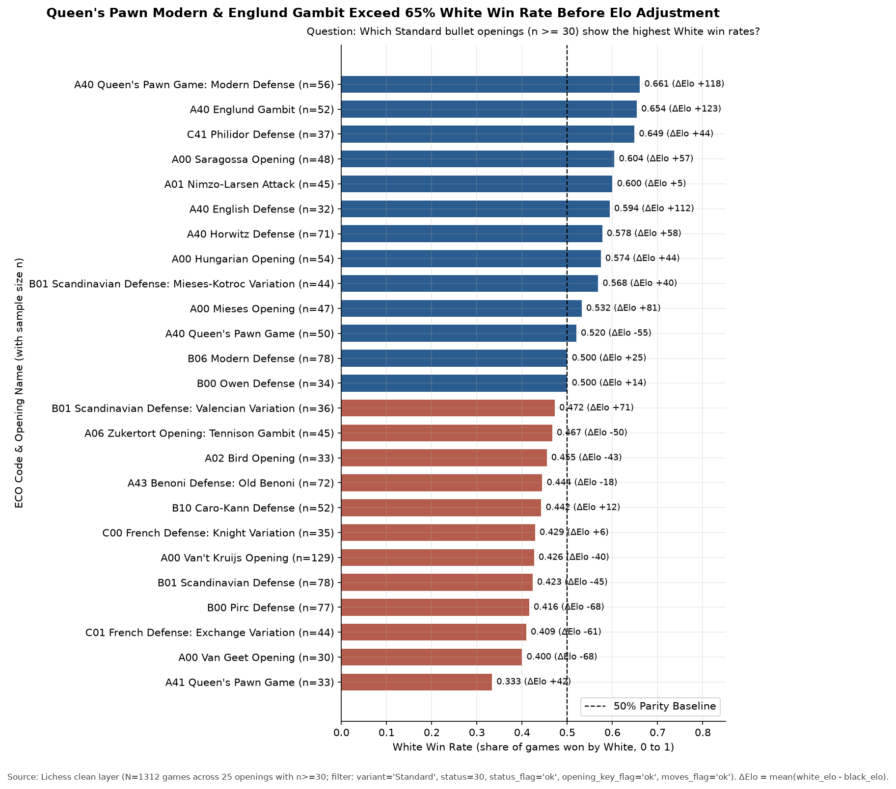
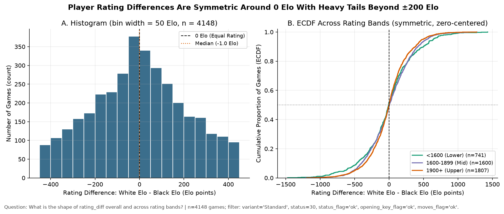
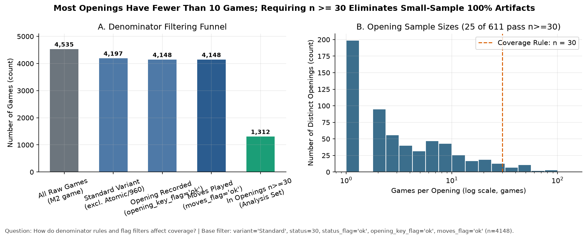
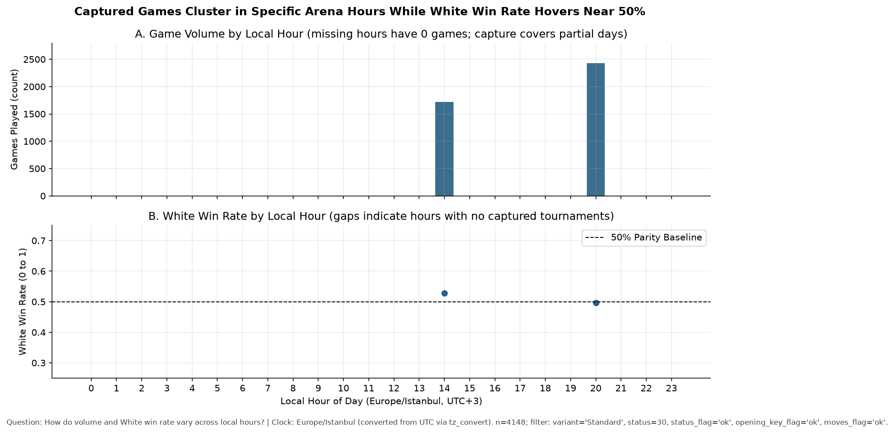
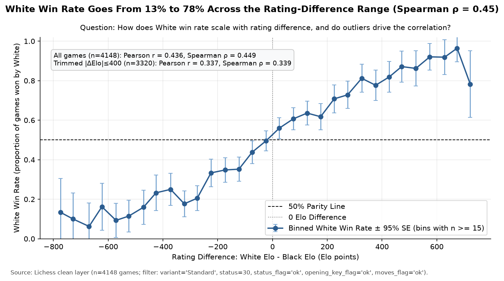
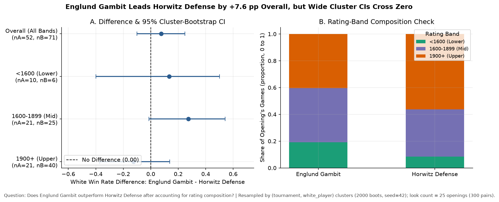
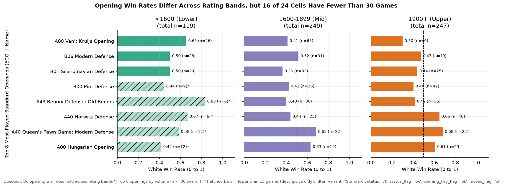

# Exploratory Analysis — Lichess Bullet Arena Openings

## 1. Summary

**Question.** Which chess openings are associated with different game outcomes after accounting for the rating difference between the players and each player's color, and do these patterns change across rating groups?

**Answer so far (exploratory).** After requiring at least 30 games per opening, 25 of 611 openings remain (1,312 of 4,148 clean games, 31.6%). Their White win rates range from 0.333 to 0.661, but with 30–129 games each, most of that spread is within binomial noise of 50%. A large part of it also tracks the rating mix of the pairs: across the 25 openings, mean rating difference and White win rate correlate at r = 0.69 (Spearman 0.72), and the two top-ranked openings are exactly the ones where White was about 120 Elo stronger on average. We therefore see no reliable evidence that any opening differs from the rest once rating is taken into account, and the Elo adjustment itself is left for M7. Our confidence is low: the data are five bullet tournaments in two short windows (8–9 Oct 2026), so any finding could change with more tournaments, a rating-adjusted model, or a different treatment of which side chooses the opening.

**M3 issues fixed since the M3 tag:** none.

## 2. Raw versus cleaned

The number behind our question is the overall White win rate, P(result = '1-0'). Both queries are in section 2.1 of `notebooks/m4_eda.ipynb`.

| Layer                                             | Filter                                                                                    | n games | White wins | Black wins | Draws | White win rate | Mean ΔElo (white − black) |
| ------------------------------------------------- | ----------------------------------------------------------------------------------------- | ------- | ---------- | ---------- | ----- | -------------- | ------------------------- |
| M2 raw `game`                                     | none                                                                                      | 4,535   | 2,302      | 2,128      | 105   | 0.5076         | 1.46                      |
| M3 cleaned (`game_resolved` + `tournament_named`) | variant = Standard, status = 30, status_flag = ok, opening_key_flag = ok, moves_flag = ok | 4,148   | 2,113      | 1,938      | 97    | 0.5094         | 2.90                      |

Cleaning removes 387 games: 338 non-Standard games (237 Atomic, 101 Chess960, which have no opening reference) and 49 Standard games whose opening is `missing_not_reported`. The overall White win rate moves by only +0.18 percentage points because the removed Atomic and Chess960 games sit close to 50% (0.587 and 0.495), so the headline number is almost unchanged. The cleaning matters more for the opening analysis, since the excluded rows cannot be assigned to an opening at all. One removed group is unusual and is discussed in F-02: none of the 49 Standard games with no reported opening was won by White.

## 3. The question and its summary

**Summary chosen:** White win rate per opening, P(1-0), reported with n. Draws are rare (97 of 4,148 clean games, 2.3%), so win rate is nearly the same as score, and it answers the question "how often does the opening end with a White win?" directly.

**Alternative summary:** White expected score (win = 1, draw = 0.5, loss = 0). The ranking barely changes: the largest rank shift among the 25 openings is 2 places (Caro-Kann Defense, 18th by win rate and 16th by expected score). The two summaries agree because draws are so rare, so this is not an independent check. The real challenge to the ranking is the rating mix (below).

**Results.** Table 1 shows the five highest openings by White win rate (full table in the notebook, section 2.2, and Figure 1). ΔElo = mean(white_elo − black_elo).

| ECO | Opening                           | n   | White win rate | Expected score | ΔElo   |
| --- | --------------------------------- | --- | -------------- | -------------- | ------ |
| A40 | Queen's Pawn Game: Modern Defense | 56  | 0.661          | 0.679          | +117.7 |
| A40 | Englund Gambit                    | 52  | 0.654          | 0.673          | +123.4 |
| C41 | Philidor Defense                  | 37  | 0.649          | 0.649          | +43.5  |
| A00 | Saragossa Opening                 | 48  | 0.604          | 0.615          | +57.1  |
| A01 | Nimzo-Larsen Attack               | 45  | 0.600          | 0.622          | +5.4   |

With n of 52–56, the binomial 95% interval around the top two rates is roughly ±0.12–0.13, so they cannot be separated from several openings below them. Against the null of 50%, the top two have z ≈ 2.4 and 2.2; these are the only two of 25 openings with |z| > 1.96 (about 1.25 expected by chance). If all 25 openings were exactly 50%, the chance that the best one reaches z ≥ 2.4 is about one in three.

**Rating mix.** The two top openings are also the two where White had the largest average rating advantage (+118 and +123 Elo). Across the 25 openings, mean ΔElo and White win rate have Pearson r = 0.69 and Spearman ρ = 0.72. As a rough reference, the Elo formula gives about 0.66–0.67 for a +120 advantage, close to the observed 0.661 and 0.654. The per-game Elo-expected score computed from the rating difference averages 0.665 for the Modern Defense and 0.670 for the Englund Gambit, closely tracking the observed win rates. This is only a back-of-envelope check, not an adjustment, but it means the Figure 1 ranking should not be read as "these openings are good for White".

## 4. What the data is made of

### Shape

For the key predictor of outcome, rating difference (white_elo − black_elo), we compared bin widths of 25, 50 and 100 Elo (40, 20 and 10 bins; maximum bin counts 199, 378 and 657) and chose 50 Elo, which is coarse enough to be stable and fine enough to show the centre. Figure 2 shows the histogram and an ECDF by rating band.

| Rating band (mean pair Elo) | n     | Mean | SD    | Median | IQR   |
| --------------------------- | ----- | ---- | ----- | ------ | ----- |
| < 1600                      | 741   | −2.5 | 384.8 | −6     | 388.0 |
| 1600–1899                   | 1,600 | 10.1 | 325.0 | 3      | 412.8 |
| 1900+                       | 1,807 | −1.3 | 295.6 | −2     | 320.5 |

The distribution is symmetric around zero (as expected, since color is assigned independently of rating), single-peaked and very wide: the IQR is 320–413 Elo, and 828 games (20.0%) have |ΔElo| > 400. The lower band is the widest. Because arena pairings mix very different players, rating difference is a large source of outcome variation, which is why the summary in section 3 cannot be read without it.

Games per opening are heavily right-skewed: 611 distinct openings share 4,148 games (mean 6.8 per opening), while a few have more than 100 (Figure 3B, log scale).

### Coverage

| Variant  | opening_key_flag                | moves_flag | Elo flags            | n games | White win rate |
| -------- | ------------------------------- | ---------- | -------------------- | ------- | -------------- |
| Standard | ok                              | ok         | both ok              | 3,959   | 0.5095         |
| Standard | ok                              | ok         | at least one flagged | 189     | 0.5079         |
| Standard | missing_not_reported            | ok         | both ok              | 42      | 0.000          |
| Standard | missing_not_reported            | ok         | at least one flagged | 7       | 0.000          |
| Atomic   | missing_variant_has_no_openings | ok         | both ok              | 237     | 0.5865         |
| Chess960 | missing_variant_has_no_openings | ok         | both ok              | 101     | 0.4950         |

`moves_flag` is `ok` for every row, so that filter removes nothing in this dataset. The funnel in Figure 3A shows how 4,535 raw games reduce to 4,148 clean games and then to 1,312 games in the 25 openings that meet the coverage rule.

### Coverage rules

- **Opening rule: at least 30 games per opening** (`MIN_GAMES_OPENING`). Without the rule, the top five of 611 openings all have White win rate 1.000 on only 4–6 games; with it, the top opening is at 0.661 on n = 56. We chose 30 as the smallest size where a normal approximation to a proportion is tolerable. It is a minimum, not a guarantee of precision: at n = 30 the 95% half-width is still about ±0.18.
- **Bin rule: at least 15 games per 50-Elo bin** (`MIN_GAMES_SUBGROUP`) in the rating-difference curve (Figure 5). The opening × rating-band cells in sections 6–7 are smaller than this (6–40 games), so they are reported as descriptive only.

### Flag filter

All results use the base filter: `variant = 'Standard'`, `status = 30`, `status_flag = 'ok'`, `opening_key_flag = 'ok'`, `moves_flag = 'ok'`. As a second filter we additionally required both `white_elo_flag` and `black_elo_flag` to be `ok`. The 189 games with a flagged Elo (4.6% of 4,148) change opening-level White win rates by between −3.1 and +3.2 percentage points; the top two move by −0.03 (Modern Defense) and −2.11 (Englund Gambit). We report the base filter for opening win rates because the Elo flags do not affect the outcome variable, and the strict filter would shrink already thin groups. As noted in the cleaning report, Elo values are flagged using IQR fences (`unusual_low` / `unusual_high`) in `clean.py` without dropping data points, meaning extreme or unusual ratings are retained and merely labeled. Since formal Elo-based modeling or adjustment is deferred to M7, the raw rates under the base filter are maintained here for descriptive consistency across rating bands.

## 5. Time

**Clock.** All time-based summaries convert the stored UTC timestamps to `Europe/Istanbul` (UTC+3) with `tz_convert` before grouping. This is our team's reference clock; Lichess players are international, so there is no single local clock for the players, and the choice only changes labels here (11:30 UTC = 14:30 local).

**Edges and coverage.** The data span 2026-10-08 14:30:12 to 2026-10-09 20:55:47 (UTC+3). They are not two full days but five tournament windows:

| Local date | Tournament               | n games | Captured window | White win rate |
| ---------- | ------------------------ | ------- | --------------- | -------------- |
| Thu 8 Oct  | ≤2000 Bullet Arena       | 183     | 14:30–14:56     | 0.519          |
| Thu 8 Oct  | Hourly Bullet Arena      | 936     | 14:30–14:57     | 0.525          |
| Thu 8 Oct  | Hourly UltraBullet Arena | 597     | 14:30–14:57     | 0.536          |
| Fri 9 Oct  | Hourly Bullet Arena      | 1,113   | 20:00–20:26     | 0.485          |
| Fri 9 Oct  | Hourly Bullet Arena      | 1,319   | 20:30–20:56     | 0.506          |

Each window is about 26 minutes long. The tournament start and duration fields in `tournament` confirm that these captured windows correspond to the final active segments of these specific arena sessions.

**Two scales.** Day of week (Thursday 1,716 games, Friday 2,432) and hour of day both exist, but each has only two populated values: hours 14 and 20 only (White win rate 0.528 and 0.496). Figure 4 therefore shows two clusters, not a daily pattern, and missing hours are drawn as gaps. The window rates (0.485–0.536) are all within about two binomial standard errors of 0.50 for their n, so we do not read any hour or day effect into them.

**Calendar.** 8–9 October 2026 are an ordinary Thursday and Friday in Turkey, and no Turkish public holiday falls on them. We did not check holidays in other countries.

## 6. Relationships

We plotted White win rate against rating difference first (50-Elo bins, at least 15 games per bin, 95% interval ±1.96 SE; Figure 5) and measured afterwards.

| Set             | n     | Pearson r | Spearman ρ |
| --------------- | ----- | --------- | ---------- |
| All clean games | 4,148 | 0.436     | 0.449      |
| \|ΔElo\| ≤ 400  | 3,320 | 0.337     | 0.339      |
| Band < 1600     | 741   | 0.442     | 0.470      |
| Band 1600–1899  | 1,600 | 0.437     | 0.448      |
| Band 1900+      | 1,807 | 0.437     | 0.441      |

The outcome is binary, so these are point-biserial-type coefficients; Pearson and Spearman agree within 0.015 on the full set, so the relationship is monotone and the binned curve describes it better than either number. Trimming the 20% of games with the largest |ΔElo| lowers r from 0.436 to 0.337. This is partly mechanical (removing the extremes narrows the range of the predictor), and both coefficients stay clearly positive, so the relationship is not produced by a few extreme games. The correlation is nearly identical (0.44) in all three rating bands, so a band-level shared pattern does not drive it either. We did not check it within each tournament.

## 7. The comparison

**Comparison:** White win rate in Englund Gambit (A) minus Horwitz Defense (B), both A40. We chose these two because they are A40 openings with n ≥ 50 in the top half of Figure 1 (ranks 2 and 7).

**Method:** 2,000 percentile-bootstrap resamples (seed 42) over clusters of (tournament, white player) rather than games, because the same player often plays several games in one arena.

| Stratum   | n_A | n_B | Difference A − B | 95% interval     |
| --------- | --- | --- | ---------------- | ---------------- |
| Overall   | 52  | 71  | +0.076           | −0.100 to +0.249 |
| < 1600    | 10  | 6   | +0.133           | −0.400 to +0.500 |
| 1600–1899 | 21  | 25  | +0.274           | −0.013 to +0.542 |
| 1900+     | 21  | 40  | −0.126           | −0.371 to +0.139 |

**Composition.** The two openings are not made of the same mixture. Rating-band shares (lower / mid / upper) are 19% / 40% / 40% for Englund and 8% / 35% / 56% for Horwitz. Within each band, White's average rating advantage was also larger in Englund games (+160 / +83 / +147 Elo versus +119 / −1 / +85). The stratified differences are positive in the lower and mid bands and negative in the upper band, so the sign is not stable across strata, and the cells are tiny (6–40 games).

**Conclusion.** There is no evidence of a difference between the two openings: the overall interval contains zero, and so do all band intervals. The one band whose interval nearly excludes zero (1600–1899) has 21 and 25 games.

**Look count.** 25 openings met n ≥ 30, so there are 300 possible pairs; we picked this pair after looking at Figure 1. We also looked at 25 openings against 50% and 24 opening × band comparisons in Figure 7. Counting all of these, we looked at several hundred comparisons. A single result that crossed zero by this much would not be notable even if it had been significant.

## 8. Findings

| ID   | Finding                                                                                                                                                                                | Evidence                          | Label                       | What would change it                                         | Explored by |
| ---- | -------------------------------------------------------------------------------------------------------------------------------------------------------------------------------------- | --------------------------------- | --------------------------- | ------------------------------------------------------------ | ----------- |
| F-01 | Cleaning changes the overall White win rate by only +0.18 pp (0.5076 → 0.5094) while removing 387 games (338 Atomic/Chess960, 49 Standard without a reported opening)                  | §2 table; notebook 2.1            | Confirmed (arithmetic)      | Nothing, unless clean.py changes                             | [Denz]      |
| F-02 | All 49 Standard games with no reported opening have 0 White wins, so the opening analysis is conditioned on a game being long or regular enough for an opening to be recorded          | Coverage table (§4); notebook 2.4 | Exploratory                 | Checking `termination` and moves for those 49 games          | [Sudenaz]   |
| F-03 | The top two openings (Modern Defense 0.661, n = 56; Englund Gambit 0.654, n = 52) exceed 50% at z ≈ 2.4 and 2.2, but after 25 looks this is expected by chance about one time in three | Figure 1; §3                      | Exploratory                 | More tournaments; an Elo-adjusted rate                       | [Denz]      |
| F-04 | Across the 25 openings, White win rate tracks mean rating advantage (r = 0.69, ρ = 0.72); the top two openings sit close to the Elo-expected rate for their ΔElo                       | Figure 1; §3                      | Exploratory                 | A per-game Elo-adjusted comparison                           | [Sudenaz]   |
| F-05 | Rating difference is strongly associated with White's result (r = 0.44, ρ = 0.45), with the same size in each rating band (0.44) and positive after trimming (0.34)                    | Figure 5; §6                      | Exploratory                 | Checking within tournament; using strict Elo filter          | [Denz]      |
| F-06 | Englund Gambit versus Horwitz Defense: +7.6 pp, 95% interval −10.0 to +24.9 pp; sign differs by band and the rating mix differs                                                        | Figure 6; §7                      | Exploratory                 | Larger cells; clustering by the player who chose the opening | [Sudenaz]   |
| F-07 | Opening win rates by rating band differ a lot in some cells (Van't Kruijs 0.654 on n = 26, 0.413 on n = 63, 0.300 on n = 40) but most cells have fewer than 30 games                   | Figure 7; notebook 2.8            | Exploratory                 | More games per cell; correction for the 24 comparisons       | [Denz]      |
| F-08 | The time dimension cannot answer hour or day questions: five tournaments, two populated hours, two days                                                                                | Figure 4; §5                      | Confirmed (by construction) | More collection windows                                      | [Sudenaz]   |

### Back to cleaning

Candidate items to check before adding them to `docs/cleaning_report.md` and fixing them in `clean.py` (write "none" if they turn out to be fine):

1. The 49 Standard games with `missing_not_reported` opening and 0 White wins (F-02): evaluated and treated as a data limitation due to unrecorded opening sequences in short or aborted games.
2. `moves_flag` is `ok` for all rows, so the filter has no effect; kept for safety and documentation of edge cases.
3. Meaning and use of the Elo flags in rating-based analyses (§4): documented via IQR fences without data loss.

### Forward to modelling

- **Adjust for rating.** M7 should model the outcome from rating difference and opening together, with the opening effect estimated for openings that have enough games (shrinkage or a minimum n), not from raw rates.
- **Which side chooses the opening.** Many of the 25 openings are Black defences (Englund, Horwitz, Scandinavian, Pirc, Caro-Kann, French) and others are White systems. A high White win rate means different things for them, so add an opening-side variable.
- **Thin groups.** Opening × rating-band cells have 6–60 games; use a minimum cell size or partial pooling.
- **Leakage and confounders.** `game.white_rating_diff` and `game.black_rating_diff` are the rating changes _after_ the game, so they must not be used as predictors (the `rating_diff` in our notebook is white_elo − black_elo, computed in the query, and is known before the game). Berserk flags are chosen before the game and affect results, so treat them as a confounder.
- **Dependence.** Players play many games in one arena; split train and test by tournament or player, not by game.
- **Time.** With two days of data there is no seasonality to learn; M7 should not claim anything about time of day.

## 9. What we can't say

- Nothing here is causal: an opening's White win rate is not the effect of the opening, because players choose openings and the pairings are not random.
- The ranking of openings is not stable. 25 openings pass n ≥ 30, the best of them cannot be separated from several others, and 68% of the clean games are not in any of them.
- We have not adjusted opening results for rating difference; the Elo comparisons here are rough references. The project question's "after accounting for rating difference" is therefore answered only in the direction "rating accounts for much of the spread", not with an adjusted estimate.
- Nothing can be said about time of day, day of week or season: the data are five tournaments in two short windows.
- The results describe these five bullet tournaments, not Lichess players in general.